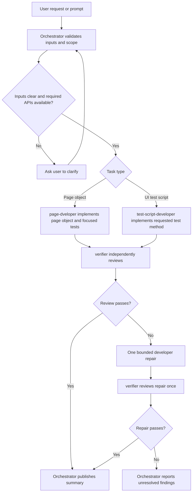

# Agent Workflow

Use the repository's [Copilot instructions](.github/copilot-instructions.md) for shared engineering conventions, architecture, and validation guidance. The custom agents under `.github/agents/` implement the specialized Selenium workflows below.

## Selenium page-object tasks

For a request to create or update a Selenium page object, use the `orchestrator` agent:

1. Validate the page name, URL, target page-object path, and requested controls. Ask for missing or genuinely ambiguous details before delegating.
2. Delegate implementation and focused, browser-free tests to `page-dveloper`. The developer follows [page-object instructions](.github/instructions/page-dvelopemet.instructions.md) and the [page-dveloper skill](.github/skills/page-dveloper/SKILL.md).
3. Have `verifier` independently review locator evidence, behavior, scope, and validation.
4. If review finds actionable issues, allow one repair by `page-dveloper` and one final verifier review. Then report the result; do not loop again.

## Selenium UI test-script tasks

For a request to implement a test from a written test case, use `orchestrator`:

1. Validate the test-case file, target Java test file, and exact test method. Read the case, target method, relevant page objects, test base, and build configuration. Confirm the required page-object APIs exist; ask before delegating if inputs or behavior remain unclear.
2. Delegate the bounded test-method change to `test-script-developer`. It follows [test-script instructions](.github/instructions/test-script-development.instructions.md) and the [test-script-development skill](.github/skills/test-script-development/SKILL.md), and should use existing page-object methods.
3. Have `verifier` independently check case-step coverage, assertions, page-object reuse, test conventions, scope, and safe validation.
4. If review finds actionable issues, allow one repair by `test-script-developer` and one final verifier review. Then publish the outcome; do not loop again.

## Workflow constraints

- A prompt file is an optional shortcut, not a substitute for validating the user's request. The workflow is also available for direct requests.
- The verifier reviews delegated changes but does not implement fixes. The orchestrator owns the final user-facing summary.
